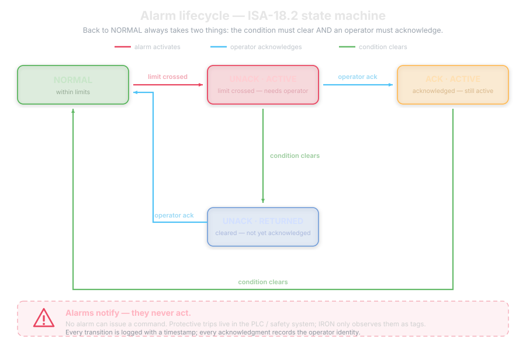

# Alarm Engine

Alarms are how the system talks to humans about abnormal conditions. IRON's
alarm design follows the vocabulary and lifecycle of **ISA-18.2** (Management
of Alarm Systems for the Process Industries) — the standard that exists because
badly designed alarm systems have contributed to real industrial accidents.

## The prime rule: alarms notify, they never act

An IRON alarm MUST NOT trigger a command. No `action:` field exists in alarm
configuration, deliberately. `REQ-ALM-001 unit`

Why this is non-negotiable:

1. **Architecture.** The alarm engine is a READ-path consumer. An alarm that
   sends a command entangles READ and WRITE — the exact monolith mistake IRON
   exists to refuse ([read-write-separation.md](read-write-separation.md)).
2. **Physics.** An automatic protective reaction (trip, interlock, emergency
   shutdown) must not have a network, a broker, and two processes between cause
   and effect. That logic belongs in the PLC scan cycle — and for
   safety-rated functions, in a dedicated safety PLC. IRON *observes* interlock
   and trip states as tags; it is never the mechanism that enforces them.

If you find yourself wanting `alarm → command`, the correct designs are:

- **Protective action** → implement in the PLC / safety system; expose its
  status as a tag so IRON can display and historize it.
- **Operator-mediated response** → the alarm notifies; a human sends the
  command through the full WRITE path with RBAC and audit.

## Where alarms are evaluated

| Level | Component | Responsibility |
|---|---|---|
| Detection | Edge agent | Evaluate limits on every scan, before deadband; publish ACTIVE/RTN transitions; keep working during network loss ([edge-agent.md](edge-agent.md)) |
| Management | iron-server | State machine, acknowledgment, shelving, suppression, escalation, notification routing, alarm history |

Detection lives at the edge because the edge is the component guaranteed to be
alive next to the process. Management lives at the server because it needs
humans, history, and routing.

One exception, stated rather than hidden: an alarm on a derived tag whose
inputs span several edges is detected by the server, because no single edge
sees all the inputs ([tag-model.md](tag-model.md)). Such an alarm does not
survive loss of the server, and `iron validate` warns when it is priority 1.

## Alarm state machine (ISA-18.2)



```
            limit crossed                 operator ack
  NORMAL ───────────────► UNACK_ACTIVE ───────────────► ACK_ACTIVE
     ▲                        │                              │
     │                        │ condition clears             │ condition clears
     │ operator ack           ▼                              ▼
     └─────────────── UNACK_RTN  ◄───────────────────────  NORMAL
                      (returned to normal, not yet acknowledged)
```

- Every transition is recorded in the historian with timestamp and (for ack)
  the operator identity.
- Acknowledgment requires the `operator` role minimum and is itself an audited
  action (but not a command — it changes alarm state, not machine state).

## Alarm definition

```yaml
# in config/tags/reactor_01.yaml
alarms:
  high:
    limit: 180
    priority: 2
    message: "High reactor temperature"
    deadband: 1.0          # alarm hysteresis: clears at 179.0, not 179.99
    on_delay: 3s           # condition must hold 3s before ACTIVE (anti-chatter)
    # Optional ISA-18.2 rationalization fields:
    cause: "Cooling water flow loss or exothermic excursion"
    consequence: "Product degradation above 185°C"
    operator_action: "Verify cooling pump P-101, reduce feed rate"
```

| Field | Required | Meaning |
|---|---|---|
| `limit` | yes, analog tags | Threshold in engineering units (within tag `range`) |
| `state` | yes, `bool` tags | The alarming state (`true` or `false`) — discrete alarms (trip, power loss) have no threshold. Exactly one of `limit`/`state` per alarm |
| `priority` | yes | 1 (critical) – 4 (low); drives sort order, color, notification policy |
| `message` | yes | What the operator sees |
| `deadband` | no | Hysteresis for clearing — prevents chatter at the limit |
| `on_delay` / `off_delay` | no | Time qualification before transition |
| `suppressed_when` | no | Boolean expression; see flood control below |
| `adjustable` | no (default `true`) | Whether `limit`, `deadband`, and the delays may be tuned on a running site ([config-lifecycle.md](config-lifecycle.md)) |
| `cause` / `consequence` / `operator_action` | no | Rationalization; displayed in the alarm detail view |

`iron validate` enforces: limits within range, ordering
(`low_low < low < high < high_high`), priorities in 1–4, and that `limit`
appears only on analog tags and `state` only on `bool` tags.

*(This discrete-alarm form was surfaced by writing
[examples/greenhouse](../../examples/greenhouse/README.md) — the example
exists precisely to catch what the prose missed.)*

## Detection semantics

What "the limit is crossed" means, exactly — the part of the alarm engine
that runs at the edge on every scan and that the
[conformance vectors](../../conformance/README.md) pin down.

- On a numeric tag an alarm MUST be named `low_low`, `low`, `high`, or
  `high_high`; the name gives the direction. On a `bool` tag the name is
  free and `state` gives the alarming state. `REQ-ALM-004 unit`
- A `high` or `high_high` alarm MUST become active when the value is at or
  above its limit; a `low` or `low_low` alarm when the value is at or below
  it. The limit itself is in alarm. `REQ-ALM-005 unit`
- An active alarm MUST clear only when the value has moved back past the
  limit by the alarm's `deadband`: at or below `limit − deadband` for a high
  alarm, at or above `limit + deadband` for a low one. With no `deadband` it
  clears as soon as the value is strictly back on the normal side. `REQ-ALM-006 unit`
- With `on_delay`, the condition MUST hold continuously for that long before
  the alarm becomes active; with `off_delay`, the clear condition likewise.
  A condition that lapses during the delay starts over. The transition is
  timestamped at the moment the delay elapsed. `REQ-ALM-007 unit`
- A sample with quality `BAD` MUST NOT change an alarm's state in either
  direction, and it cancels a delay in progress: an unreadable sensor is
  neither evidence of an alarm nor of its absence. The quality change is
  itself published and visible ([edge-agent.md](edge-agent.md)). `UNCERTAIN`
  samples are evaluated normally. `REQ-ALM-008 unit`

## Alarm flood control

The most common failure of real alarm systems is not a missed alarm — it is
2,000 alarms in one minute after a section trip, burying the one that matters.

- **Shelving.** An operator may shelve a nuisance alarm for a bounded time
  (e.g. 8h max). Shelving is audited, visible in a "shelved" list, and expires
  automatically. Shelving MUST NOT be available for priority-1 alarms. `REQ-ALM-002 unit`
- **Suppression by design.** An alarm can declare a suppressing condition:
  `suppressed_when: "pump_01.running == false"` — a "low flow" alarm is
  meaningless when the pump is intentionally off. The condition is a boolean
  [expression](expressions.md) over tags, evaluated by the server.
  Suppressed alarms are still detected but not annunciated; they appear in a
  "suppressed" list. Suppression fails toward annunciation: if any tag the
  condition reads is not `GOOD`, the alarm is **not** suppressed. Detection
  at the edge is unaffected, so the edge's local notification channel
  ignores suppression — during a server outage, more alarms is the safe
  direction.
- **Flood detection.** If annunciation rate for an area exceeds a threshold
  (default: 10 alarms / 10 min / operator station, per ISA-18.2 guidance), the
  UI collapses to a priority-sorted summary view and the event is itself logged
  — flood episodes are reviewable afterwards.
- **First-out.** Alarm groups MAY declare first-out behavior: in a trip
  cascade, the first alarm in the group is flagged as the probable initiator.

## Escalation and notification

```yaml
# config/alarms/escalation.yaml
policies:
  critical:                       # applies to priority 1
    - notify: [shift_operator]    # immediately: UI + Telegram
    - after: 5m                   # unacknowledged after 5 minutes:
      notify: [shift_supervisor]
    - after: 15m
      notify: [plant_manager]
```

Notification channels are pluggable (Telegram first, then email/SMS/webhook).
Channel failures are logged and retried; a notification failure MUST be visible
in the UI ("escalation delivery failed"), never silent. `REQ-ALM-003 unit`

## Metrics

The alarm engine tracks and displays its own health, because an unhealthy alarm
system is a process hazard: annunciation rate per operator, % time in flood,
top-10 most frequent alarms (chattering candidates), shelved count and ages,
stale alarms (active > 24h). These map to the ISA-18.2 performance metrics and
are first-class dashboard widgets, not an afterthought.
