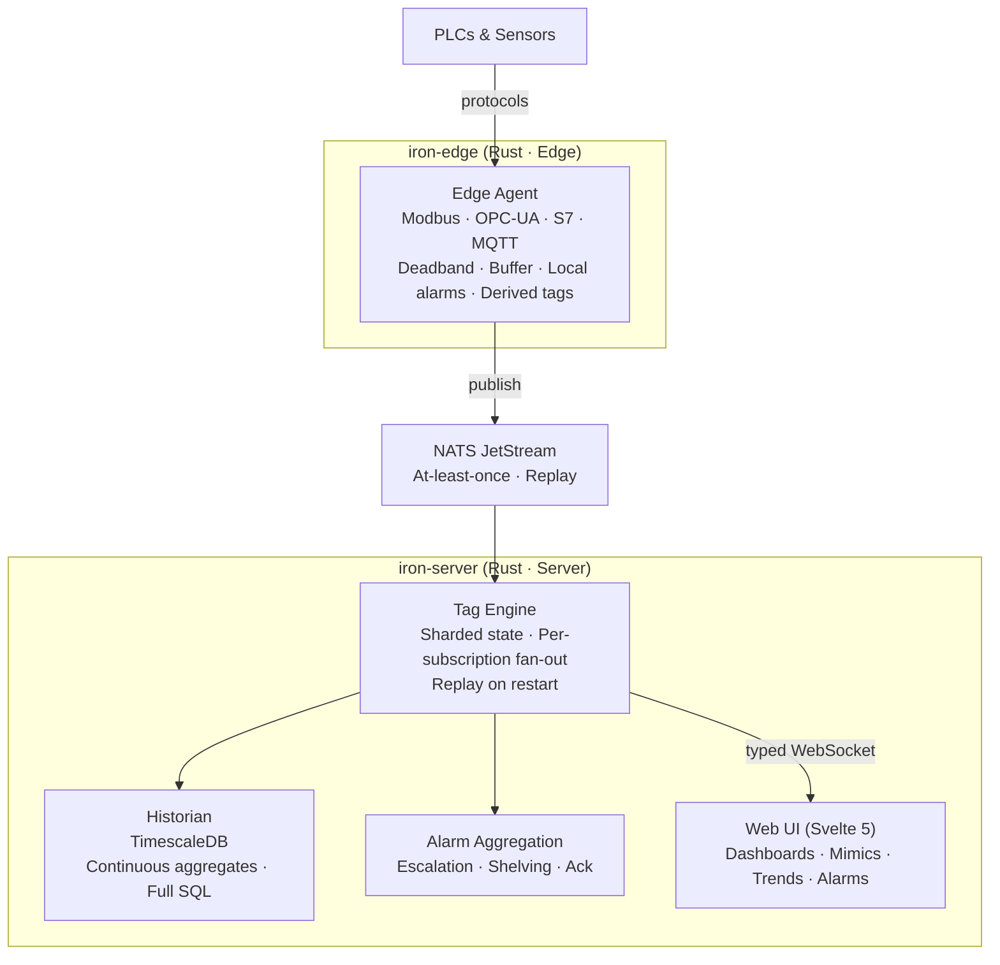

# System Architecture

IRON has a two-layer architecture with a clear boundary between runtime and interface.

```
┌─────────────────────────────────────────────────────────────────┐
│  FIELD LEVEL                                                     │
│  PLCs: Siemens S7 · Allen-Bradley · CLICK PLUS · Soft PLC       │
│  Sensors: IO-Link · 4-20mA · HART · Vibration                   │
│  Protocols: Modbus TCP/RTU · OPC-UA · S7 · MQTT                 │
└───────────────────────────┬─────────────────────────────────────┘
                            │
┌───────────────────────────▼─────────────────────────────────────┐
│  iron-edge  (Rust)                                               │
│                                                                  │
│  Edge Agent — see specs/edge-agent.md                            │
│  • Protocol drivers: Modbus, OPC-UA, S7, MQTT                   │
│  • Deadband filtering with alarm-limit override                  │
│  • First-level alarm evaluation (local, autonomous)              │
│  • Data quality: GOOD / UNCERTAIN / BAD                         │
│  • Local SQLite buffer — survives network loss                   │
│  • Derived tags — expressions over the tags it owns              │
└───────────────────────────┬─────────────────────────────────────┘
                            │ transport contract (in-process · NATS JetStream)
                            │ tag address: reactor_01.temperature
┌───────────────────────────▼─────────────────────────────────────┐
│  iron-server  (Rust)                                             │
│                                                                  │
│  • Tag Engine — sharded in-memory state, per-subscription fan-out│
│  • Alarm aggregation, escalation, acknowledgment                  │
│  • Historian — TimescaleDB (PostgreSQL + time-series)            │
│  • Command Service — the only WRITE entry point                   │
│  • REST API · typed WebSocket · RBAC · Audit log                  │
│  • MCP server — agent interface (same core as the CLI)            │
│  • Embedded UI assets — Svelte 5 dashboards, mimics, editor       │
└───────────────────────────┬─────────────────────────────────────┘
                            │ WebSocket (typed protocol)
                        Browser / Mobile
```

Both `iron-edge` and `iron-server` are crates in one Cargo workspace and
share `iron-domain` — the pure tag/quality/deadband/alarm logic, written
once, compiled to native and to WASM
([ADR 0009](../decisions/0009-rust-for-the-server.md)). The `iron` binary
contains the CLI, the server, the simulator, and the MCP server
([agent-interface.md](agent-interface.md)).



## Responsibilities

| Component | Owns | Must never do |
|---|---|---|
| Edge agent (iron-edge) | Polling, conversion, quality, deadband, buffering, first-level alarm evaluation, executing authorized commands | Originate commands on its own |
| NATS JetStream | Transport between edge and server, replay, at-least-once delivery | Hold business logic |
| iron-server | Visualization, historian, alarm aggregation/escalation, RBAC, audit, Command Service, agent interface | Bypass the Command Service for writes |
| Browser | Display, operator interaction | Talk to the edge or PLC directly |

## Communication layer

What the edge and the server say to each other — message kinds, delivery
guarantees, the session handshake — is one contract, specified in
[transport.md](transport.md), with two bindings:

- **In-process channels** in the default single-binary deployment.
- **NATS JetStream** in plant mode, when edge and server are separate hosts
  ([decisions/0003-nats-jetstream.md](../decisions/0003-nats-jetstream.md)).

Properties of the contract that shape everything else:

- Every tag has exactly one canonical address, its dotted path
  (`reactor_01.temperature`) — the Unified Namespace concept. In the
  NATS binding it maps to the subject `data.<site>.reactor_01.temperature`,
  and `data.<site>.reactor_01.>` is all of reactor 01.
- Data is at-least-once and replayable; a restarted server catches up.
- Commands are at-most-once and never stored.
- Data and commands live in **separate authorization scopes** —
  see [read-write-separation.md](read-write-separation.md) and [security.md](security.md)

## Scaling design

> **Status: design targets.** Nothing described here is built yet — the code
> so far validates and simulates. The numbers below
> describe how the architecture is intended to behave, derived from published
> benchmarks of the underlying technologies — not from measurements of IRON
> itself. Converting them into measured facts (100k simulated tags, 50
> concurrent operator sessions, fixed reference hardware) is an explicit
> Phase 1 milestone — see the [roadmap](../business/roadmap.md).

A mid-size refinery has 100,000 tags updating every second. Three filtering layers
make this tractable:

```
Layer 1 — Deadband (Rust edge agent)
  100,000 polls/sec → ~10,000 publishes/sec
  (typical −80–90% for analog tags; digital tags publish only on change)

Layer 2 — Tag-state routing (Rust server)
  Each tag = one entry in a sharded in-memory map, not a process
  Target: 100,000 tags in tens of MB, not hundreds
  Updates go only to subscribers of that tag, not broadcast

Layer 3 — Client subscription (typed WebSocket)
  Operator opens a pump station screen
  → subscribes to the 50–200 visible tags only
  → browser receives 50–200 updates/sec, not 10,000
```

An operator viewing a pump station screen receives updates for the tags on that
screen. Not 100,000. This is the difference between correct and naive architecture.

### Reference numbers for the underlying technologies

These are vendor/community published figures for the components in isolation,
under their own benchmark conditions. They bound what is possible; they do not
describe IRON. IRON will publish its own measured numbers when a prototype exists.
No external number is cited for the Rust server's fan-out: IRON targets
hundreds of concurrent operator sessions, and that is measured in Phase 1,
not borrowed from someone else's benchmark.

| Claim | Source | Caveat |
|---|---|---|
| NATS core: millions of msg/sec | NATS benchmarks | Core NATS, in-memory. JetStream (persistent, at-least-once) is significantly slower — plan around ~100k–1M msg/sec, still far above IRON's needs |
| TimescaleDB: ~1M rows/sec insert | TimescaleDB benchmarks | Batched inserts on server-class hardware |
| TimescaleDB: 8–12× compression | TimescaleDB documentation | Workload-dependent |

## Network topology

```
VLAN 10 (OT): PLCs, sensors, I/O modules — isolated
VLAN 20 (IT): NATS, TimescaleDB, iron-server
Firewall rule: OT → IT allowed (edge agent initiates connection to NATS)
               IT → OT blocked by default (no unsolicited access to PLCs)

The edge agent initiates the TCP connection to NATS (OT → IT).
Over this established connection, data flows both ways:
  READ:  agent publishes samples and alarm events for the areas it owns
  WRITE: agent subscribes to its own command subjects, receives authorized commands
```

See [security.md](security.md) for the authorization model that keeps these
two flows separated on a shared broker.

## What runs where

| Hardware | Cost | Use case |
|---|---|---|
| Raspberry Pi CM4 (industrial carrier) | ~$150 | Small plants, greenhouses, up to ~2,000 tags (target, unmeasured) |
| Beelink EQ12 (Intel N100, passive cooling) | ~$150 | Mid-size plants, DIN-rail mounting |
| CLICK PLUS PLC | ~$200 | PLC + edge agent on same hardware (Linux inside) |
| x86 industrial PC | $300–800 | Large plants, demanding workloads |

Full selection guidance: [guides/hardware.md](../guides/hardware.md).
Deployment modes and tooling: [deployment.md](deployment.md).
